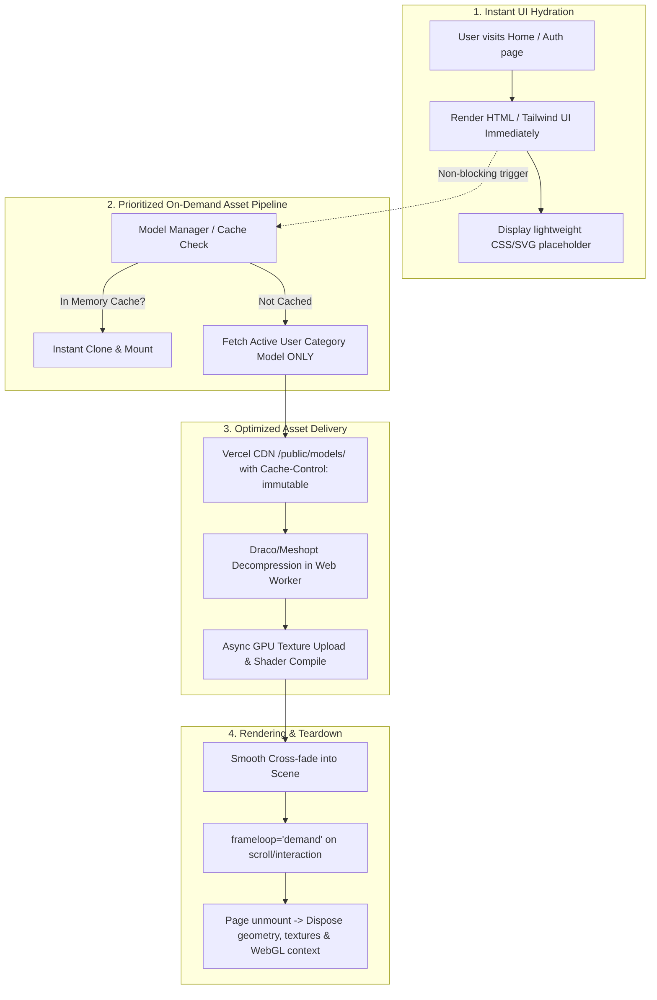

# 3D Model Performance Optimization: Implementation Plan

> **Document Type:** Senior Engineering Architecture & Performance Implementation Plan  
> **Target Application:** DiabolicalXme Frontend (`client/`)  
> **Status:** Planning Only (No application code modified)  
> **Author:** Antigravity Performance Engineering Team  

---

## 1. Executive Summary & Audit Findings

An in-depth performance audit was conducted across the 3D pipeline in `client/src`. The audit confirmed that while the 3D scenes themselves are conceptually straightforward (single model, fixed lighting, scroll/mouse rotation), multiple compounding architectural bottlenecks cause noticeable page lag, mobile thread blocking, and full-screen UI stalling.

### Confirmed Bottlenecks & File References

| # | Bottleneck | Actual File Path & Lines | Severity | Impact & Evidence |
|---|---|---|---|---|
| **B1** | **Eager Global Multi-Model Preloading** | [`client/src/components/shopping-view/BackgroundModel.jsx:205-215`](file:///d:/DiabolicalXme/client/src/components/shopping-view/BackgroundModel.jsx#L205-L215) | **Critical** | Module execution immediately triggers `useGLTF.preload()` for **6 separate GLB models** (`Arthur-v2`, `Bravo-v2`, `Hector-v2`, `Arthur-hambg`, `Bravo-hambg`, `Hector-hambg`) concurrently. At ~25 MB each, this triggers ~150 MB of unthrottled network requests upon landing on the home page. |
| **B2** | **External Third-Party Host Without Edge Caching** | [`client/src/components/shopping-view/BackgroundModel.jsx:7`](file:///d:/DiabolicalXme/client/src/components/shopping-view/BackgroundModel.jsx#L7), [`client/src/components/auth/LoginModel3D.jsx:12`](file:///d:/DiabolicalXme/client/src/components/auth/LoginModel3D.jsx#L12), [`client/src/components/auth/RegisterModel3D.jsx:24`](file:///d:/DiabolicalXme/client/src/components/auth/RegisterModel3D.jsx#L24) | **Critical** | Assets are pulled from `https://diabolicalxme.github.io/3D-assests/`. GitHub Pages does not offer Brotli compression for `.glb`, lacks custom `Cache-Control: immutable` headers, introduces external DNS/TLS handshake overhead, and bypasses Vercel's Edge CDN. |
| **B3** | **Hard UI Blocking Gate on Initial Render** | [`client/src/pages/shopping-view/home.jsx:270-272,304`](file:///d:/DiabolicalXme/client/src/pages/shopping-view/home.jsx#L270-L272) | **High** | `showLoader = ... || (isAuthenticated && use3DBackground && !isBackgroundModelLoaded)` completely covers the application with `<Loader />` until the 25 MB model finishes downloading and parsing (with a 10s timeout fallback). |
| **B4** | **Dual-Model Switch on Hamburger Scroll** | [`client/src/components/shopping-view/BackgroundModel.jsx:14-25`](file:///d:/DiabolicalXme/client/src/components/shopping-view/BackgroundModel.jsx#L14-L25) | **High** | When `scrollProgress > 0.85`, `actualModelName` switches from `${base}-v2` to `${base}-hambg`. If `-hambg` has not completed downloading, the model disappears or stalls precisely when the user scrolls down to use the menu. |
| **B5** | **Continuous Uncapped RAF Loop** | [`client/src/components/shopping-view/BackgroundModel.jsx:165`](file:///d:/DiabolicalXme/client/src/components/shopping-view/BackgroundModel.jsx#L165) | **Medium** | `<Canvas frameloop="always">` continuously renders at 60/120 FPS even when the scene is static and no scrolling is occurring, draining laptop/mobile battery and heating the GPU. |
| **B6** | **Missing Chunk Splitting for Three.js Engine** | [`client/vite.config.js:74-98`](file:///d:/DiabolicalXme/client/vite.config.js#L74-L98) | **Medium** | `three`, `@react-three/fiber`, and `@react-three/drei` are bundled directly into the main entry bundle (`dist/assets/index-D8yE8he0.js`, 1.58 MB minified), delaying First Contentful Paint (FCP) on pages that do not even render 3D models. |
| **B7** | **Duplicate Auth Components** | [`client/src/components/auth/LoginModel3D.jsx`](file:///d:/DiabolicalXme/client/src/components/auth/LoginModel3D.jsx), [`client/src/components/auth/RegisterModel3D.jsx`](file:///d:/DiabolicalXme/client/src/components/auth/RegisterModel3D.jsx) | **Medium** | Both components load the exact same asset (`Login.glb`) with identical lighting and camera setups, duplicated across 240+ lines of redundant code and separate preloads. |

---

## 2. Model Catalog & Placement Guide

To allow local hosting, Vercel CDN distribution, and offline optimization, the directory [`client/public/models/`](file:///d:/DiabolicalXme/client/public/models/) has been initialized.

### Exact Model Names & Directory Structure

```
client/
└── public/
    └── models/
        ├── Arthur-v2.glb      # Home Landing background (Arthur category)
        ├── Arthur-hambg.glb   # Hamburger mini avatar (Arthur category)
        ├── Bravo-v2.glb       # Home Landing background (Bravo category)
        ├── Bravo-hambg.glb    # Hamburger mini avatar (Bravo category)
        ├── Hector-v2.glb      # Home Landing background (Hector category)
        ├── Hector-hambg.glb   # Hamburger mini avatar (Hector category)
        └── Login.glb          # Auth views (Login, Register, Forgot/Reset Password)
```

> [!IMPORTANT]
> **Exact Filename Casing Matters:** On Vercel's Linux build and hosting environments, URLs are case-sensitive. Rename models with exact capitalization:
> - `Arthur-v2.glb` (Capital `A`, hyphen, lowercase `v2`)
> - `Arthur-hambg.glb` (Capital `A`, hyphen, lowercase `hambg`)
> - `Bravo-v2.glb`
> - `Bravo-hambg.glb`
> - `Hector-v2.glb`
> - `Hector-hambg.glb`
> - `Login.glb` (Capital `L`, lowercase `ogin`)

---

## 3. Recommended Architecture

### Proposed Loading Pipeline



---

## 4. Evaluation: React Three Fiber + Drei vs. Direct Three.js

### Comparative Evaluation Matrix

| Metric / Dimension | React Three Fiber + Drei (`@react-three/*`) | Direct Three.js (`three` + `GLTFLoader`) | Verdict for DiabolicalXme |
| :--- | :--- | :--- | :--- |
| **JS Bundle Overhead** | Adds ~370 KB (minified) for R3F, Drei, and React reconciler | Pure Three.js (`three` is already installed, ~600 KB) | **Direct Three.js wins** (saves ~370 KB bundle) |
| **Download & Parsing Speed** | Controlled by GLB size and browser thread | Controlled by GLB size and browser thread | **Tie** (both use `GLTFLoader` under the hood) |
| **Draco / Meshopt Worker Management** | Built into `useGLTF` (`draco()` helper) | Requires standard `dracoLoader.setDecoderPath('/draco/')` | **R3F is slightly more turnkey**; direct Three.js requires decoder folder in `public/` |
| **Animation & Scroll Integration** | Interacts via `useFrame` and React state hooks | Direct `requestAnimationFrame` managed in `useEffect` ref | **Direct Three.js gives cleaner RAF control** |
| **Resource Disposal & Memory Cleanup** | Automatic but can leak if `<Canvas>` remounts frequently | Explicit `geometry.dispose()`, `material.dispose()`, `renderer.dispose()` | **Direct Three.js prevents WebGL context loss** |
| **Developer Ergonomics** | Declarative JSX syntax (`<Canvas>`, `<ambientLight />`) | Imperative code (~80-120 lines in a custom hook) | **R3F is more readable for complex scenes**, but these 3 scenes are extremely simple |

### Strategic Recommendation
1. **Do not migrate to Direct Three.js as the first step.** The 25 MB delay is **not** caused by React Three Fiber; it is caused by raw asset size and eager multi-model preloading.
2. **Phase 1 Priority:** Optimize the 7 GLB files (reducing size from 25 MB to ~2-3 MB) and eliminate eager multi-model preloads.
3. **Phase 2 (Optional Refinement):** Consolidate the 3 scenes into a lean custom hook (`useThreeScene.js`) with direct Three.js if bundle size reduction of ~370 KB is desired.

---

## 5. Optimization Strategies

### Strategy A: GLB Pipeline (Size Reduction Target: 85–92%)

```
Original Raw GLB (~25 MB)
  │
  ├── 1. Texture Downsampling & WebP/KTX2: Resize 4K textures to 1K/2K, compress to WebP
  ├── 2. Mesh Optimization: gltf-transform meshopt / draco geometry quantization
  ├── 3. Prune Unused Data: Remove empty nodes, orphan animations, and hidden joints
  ▼
Optimized Production GLB (~1.8 MB - 3.2 MB)
```

#### Optimization Tooling Workflow:
Using [`@gltf-transform/cli`](https://gltf-transform.dev/cli):
```bash
# Example optimization pipeline command for each model:
npx @gltf-transform/cli optimize input.glb output.glb \
  --texture-compress webp \
  --texture-resize 2048 \
  --compress meshopt
```

### Strategy B: Elimination of Multi-Model Preloading
- **Current Pattern:** Modules eagerly execute `useGLTF.preload` for all 6 character models at file evaluation.
- **Proposed Pattern:**
  - Load **only** the model matching `user.category` (e.g., `Arthur-v2.glb` for Arthur).
  - Preload the corresponding `-hambg` model **only when user scrolls past 30%** or idle network is detected (`requestIdleCallback`).
  - Never download models for characters the user is not viewing.

### Strategy C: Single Mesh Unification for Body & Hamburger
- **Analysis:** `Arthur-v2.glb` and `Arthur-hambg.glb` represent the same character. Currently, transitioning to the hamburger menu triggers an entirely new network request.
- **Optimization:** If `-v2` contains the full mesh including head, investigate whether the mini hamburger avatar can simply adjust camera framing and clipping (as lines 41-45 in `BackgroundModel.jsx` already do), avoiding the need for a separate `-hambg.glb` download altogether.

### Strategy D: Non-Blocking UI Loading Pattern
- In [`client/src/pages/shopping-view/home.jsx`](file:///d:/DiabolicalXme/client/src/pages/shopping-view/home.jsx#L271), decouple the main page `<Loader />` from `isBackgroundModelLoaded`.
- Display a CSS/WebP silhouette placeholder while the 3D model streams in.
- Smoothly fade in the WebGL canvas once `onModelLoaded` fires.

### Strategy E: Vercel CDN & Cache Headers
Update [`client/vercel.json`](file:///d:/DiabolicalXme/client/vercel.json) to apply permanent caching to the `/models/` route:
```json
{
  "source": "/models/(.*)",
  "headers": [
    {
      "key": "Cache-Control",
      "value": "public, max-age=31536000, immutable"
    }
  ]
}
```

---

## 6. Prioritized File-by-File Implementation Plan

### Phase 1: Asset Preparation & Local Hosting (Zero Code Risk)
- **Target Files:** [`client/public/models/`](file:///d:/DiabolicalXme/client/public/models/)
- **Action:**
  1. User pastes raw models into `client/public/models/`.
  2. Run `gltf-transform` to generate optimized Draco/Meshopt + WebP variants.
  3. Validate visual integrity in [glTF Viewer](https://gltf-viewer.donmccurdy.com/).

### Phase 2: Decouple Preloading & Host from Local CDN
- **Files to Modify:**
  1. [`client/vercel.json`](file:///d:/DiabolicalXme/client/vercel.json): Add `/models/(.*)` caching headers.
  2. [`client/src/components/shopping-view/BackgroundModel.jsx`](file:///d:/DiabolicalXme/client/src/components/shopping-view/BackgroundModel.jsx):
     - Update `MODEL_BASE_URL` to point to `/models`.
     - Remove global multi-model `useGLTF.preload` calls (lines 205–215).
     - Add conditional preloading for `-hambg` based on scroll threshold.
  3. [`client/src/components/auth/LoginModel3D.jsx`](file:///d:/DiabolicalXme/client/src/components/auth/LoginModel3D.jsx) and [`RegisterModel3D.jsx`](file:///d:/DiabolicalXme/client/src/components/auth/RegisterModel3D.jsx):
     - Update model path to `/models/Login.glb`.
     - Remove redundant preloads on unvisited routes.

### Phase 3: Decouple Page Blocking in Home Page
- **File to Modify:** [`client/src/pages/shopping-view/home.jsx`](file:///d:/DiabolicalXme/client/src/pages/shopping-view/home.jsx)
- **Action:**
  - Remove `(isAuthenticated && use3DBackground && !isBackgroundModelLoaded)` from `showLoader`.
  - Let products and banner hydrate in <1 second; let the 3D canvas fade in asynchronously.

### Phase 4: Vite Chunk Splitting & WebGL Resource Cleanup
- **Files to Modify:**
  1. [`client/vite.config.js`](file:///d:/DiabolicalXme/client/vite.config.js): Separate `three`, `@react-three/fiber`, and `@react-three/drei` into a dedicated `three-vendor` chunk so non-3D routes do not pay the payload penalty.
  2. [`client/src/components/shopping-view/BackgroundModel.jsx`](file:///d:/DiabolicalXme/client/src/components/shopping-view/BackgroundModel.jsx): Switch `frameloop` to `'demand'` when `scrollProgress` is stationary.

---

## 7. Benchmarking & Verification Plan

### Metrics to Benchmark Before vs. After
| Metric | Baseline Target | Post-Optimization Target | Measurement Tool |
| :--- | :--- | :--- | :--- |
| **Initial Network Transfer on Home Page** | ~150 MB (6 models) | ~2.5 MB (1 active model) | Chrome DevTools Network tab |
| **Time to Interactive (TTI) / FCP** | > 8.0 s (waiting on loader) | < 1.5 s | Lighthouse / WebPageTest |
| **Total Model Asset Size (per model)** | ~25 MB | < 3.5 MB | File system / Network |
| **Main Thread JS Parse Time** | ~1800 ms | < 250 ms | Chrome DevTools Performance profiler |
| **GPU Memory Usage** | > 350 MB | < 80 MB | `chrome://gpu` & Three.js memory info |

### Rollback Strategy
- Original model URLs on `https://diabolicalxme.github.io/3D-assests/` remain untouched and act as a 1-line fallback in `BackgroundModel.jsx` and `LoginModel3D.jsx`.
- Git commits will isolate asset switching from component logic updates.
